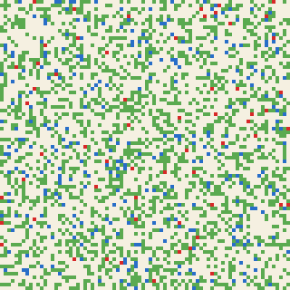
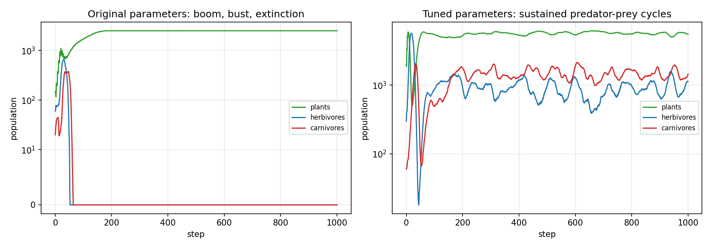
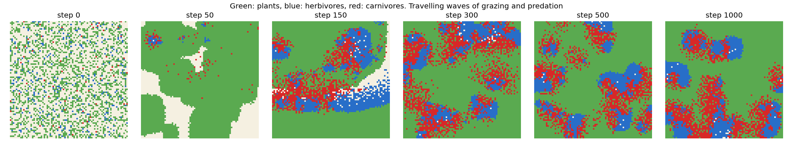
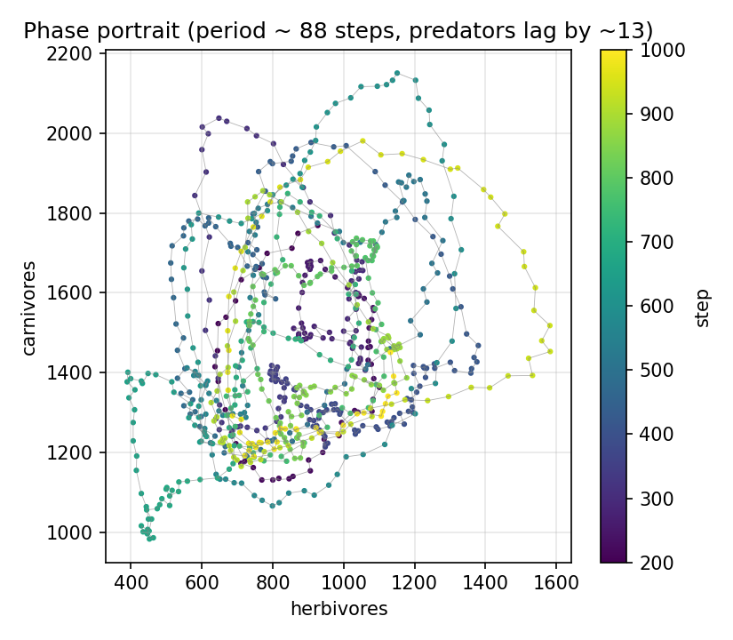

# Predator–Prey Ecosystem Simulator (C++17)

> **Course:** Advanced Programming final project, Amirkabir University of Technology. This repo is a reworked and verified version of the original submission.

An agent-based simulation of a three-level food chain on a 2-D grid: **plants → herbivores → carnivores**. It is object-oriented C++17 with a JSON config file and reproducible seeds. Each run writes CSV logs, and the Python scripts turn them into plots and an animated GIF.

<p align="center"></p>

## Model
Each step, every organism alive at the start of the step acts once, in a freshly shuffled order. At most one plant and one animal can occupy a cell.

| Species | Each turn |
|---|---|
| **Plant** | Gains `plant_energy_gain`. At `plant_reproduce_threshold` it seeds a random neighbouring cell that has no plant, giving the seedling half its energy. |
| **Herbivore** | Eats the plant in its own cell if there is one. Otherwise it moves to a free neighbouring cell, preferring cells with plants, and pays `herbivore_move_cost`. |
| **Carnivore** | Attacks a herbivore in one of the 8 neighbouring cells. The attack succeeds with probability `carnivore_hunt_success_percent`, and the carnivore then takes the prey's cell. Otherwise it wanders and pays `carnivore_move_cost`. |

Animals die when their energy reaches 0. At their reproduction threshold they split their energy with an offspring placed in a free neighbouring cell.

## Results
| | Original parameters (`config/original.json`) | Tuned parameters (`config/default.json`) |
|---|---|---|
| All three species alive after 1000 steps | **0 of 20 seeds** | **20 of 20 seeds** (also 20 of 20 over 2000 steps) |
| Behaviour | The herbivores boom, then the predators boom and eat all the prey. A species is extinct by step 44–90. | Sustained, noisy predator–prey cycles |
| Cycle | – | Period ≈ 88 steps; predators lag prey by ≈ 13 steps |



| Grid snapshots | Phase portrait |
|---|---|
|  |  |

**What makes coexistence possible.** In the original setting the predators are too efficient: a carnivore next to prey always catches it. The grid then shows the classic Lotka–Volterra overshoot, except that on a finite lattice the populations reach zero, so the cycle ends in extinction.

The tuned configuration changes four things:
- a 20 % hunt success rate
- a larger reward per catch, so predators can survive the misses
- faster plant regrowth
- a larger 80 × 80 world

The snapshots show what this produces: **travelling waves**. Herbivore fronts graze into the plants, predators chase the fronts, and plants regrow behind them. Different patches are out of phase, so the global populations no longer crash together. Spatial structure is what stabilises the predator–prey system here.

## Build, test, run
You need a C++17 compiler; [nlohmann/json](https://github.com/nlohmann/json) is included in `third_party/`. The Python scripts need numpy, matplotlib and Pillow.

```bash
make                   # or: cmake -B build && cmake --build build
make test              # 7 tests: occupancy invariants, reproducibility, starvation, predation, config validation
./build/ecosystem config/default.json --seed 1 --display      # live coloured grid in the terminal
python scripts/run_experiments.py                             # regenerates everything in results/
```

**Command-line options:** `ecosystem [config.json] [--seed N] [--steps N] [--out DIR] [--display] [--delay MS]`. Each run writes `DIR/population.csv` every step and `DIR/positions.csv` every `log_positions_every` steps.

## Code structure
```
src/
  Organism.h            abstract base: position, energy, age, alive flag
  Animal.h              shared animal turn (feed -> move -> starve -> reproduce), template-method pattern
  Plant.h  Herbivore.h  Carnivore.h   species-specific feeding and movement
  Species.cpp           behaviour of all species
  World.h/.cpp          organisms, spatial hash map (Position -> occupants), turn order, rendering, invariant checks
  Config.h/.cpp         JSON loading with validation
  RandomUtils.h         single seeded std::mt19937
  main.cpp              command line, CSV logging
tests/test_world.cpp    framework-free unit tests
scripts/run_experiments.py   runs the simulator, makes the plots and the GIF, multi-seed statistics
```

## Changes compared with the original submission
- **It did not compile.**
  - `m_pendingOrganisms` was declared twice in `World.h`.
  - `World::isCellFull` was defined twice, with different capacities.
  - `Plant::reproduce` called a constructor with three arguments that does not exist.

  The included `.exe`, CSVs and GIF came from an earlier version of the code.
- **Logging stopped after the first step.** `csvFile.close()` and `gridLog.close()` were inside the simulation loop.
- **Predation was impossible.** Carnivores only hunted in their own cell, but the one-animal-per-cell rule kept them out of any cell holding a herbivore. Hunting now targets the 8 neighbouring cells.
- **Stuck animals never died.** Energy was only spent on a *successful* move, so a surrounded animal lived forever. The cost is now paid whenever the animal doesn't eat.
- **Newborns could share a cell.** Offspring were placed without checking occupancy, and initial organisms could be stacked in one cell. Placement now respects capacity, and `World::checkInvariants()` enforces this in the tests.
- **Runs were not reproducible.** The seed was always `random_device`. Seeds now come from the config or `--seed`. The terminal display and its delay are optional, so batch runs are fast.
- **Code cleanup.**
  - The duplicated herbivore and carnivore logic now lives in an `Animal` base class.
  - Unused code was removed: `getNextId`, `countPlantsInNeighborhood` and a second ID counter.
  - The config is validated.
  - The Makefile tracks header dependencies, and there is a CMake build and unit tests.
- **Mislabelled plot.** The plot was titled "Lotka–Volterra model". This is an agent-based model that *shows* Lotka–Volterra-like cycles; the README now explains when it does and when it doesn't.

**Sepehr Ebrahimi**, B.Sc. Electrical Engineering, Amirkabir University of Technology (2026)
